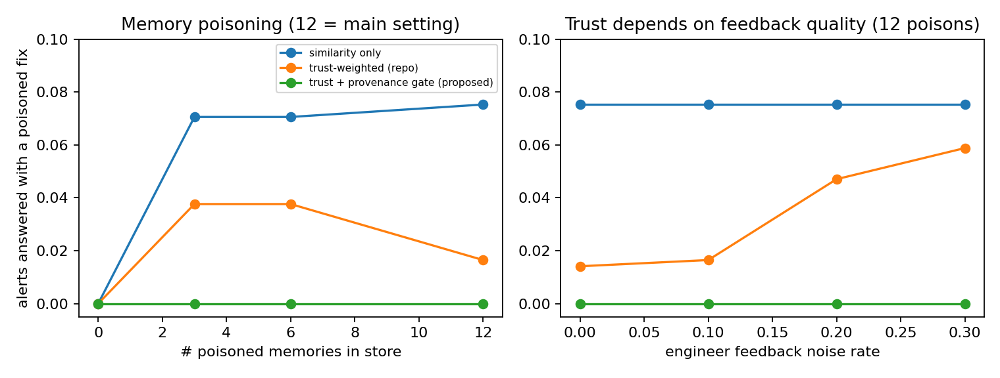

# Poisoned Memories: Retrieval and Trust in Incident-Memory Agents on Real Postmortems

**Karthik Mulugu** — draft, November 2026. Code and data in `research/`. Everything runs locally (Ollama: `qwen3:8b` to build the benchmark, `nomic-embed-text` for retrieval).

## Abstract

On-call agents with persistent memory recall a team's past incidents to suggest where to look when a new alert fires. Two things decide whether that helps: whether a reworded recurrence of an old failure finds the right memory, and whether a wrong or malicious memory can take over the agent's answer. We build **PMBench** from 170 real public postmortems (Amazon, Cloudflare, CircleCI, GitHub and others): each incident has two independently worded, symptom-only alerts (first occurrence and later recurrence), a correct lesson and a plausible but wrong lesson. Matching a reworded recurrence is hard: dense retrieval over postmortem summaries puts the right incident first 31.2% of the time; storing the triggering alert with the resolution raises this to 37.6%, and hybrid dense + BM25 scoring to 41.8% (65.9% in the top 5). We then plant stale wrong lessons and adversarial "poisoned" memories — generic symptom text paired with a harmful fix such as disabling authentication — and replay a realistic feedback loop. With pure similarity ranking, **three poisoned memories are served as the agent's fix for 7.1% of alerts**. The trust-weighted ranking used in production (distance − 0.15 × confidence, confidence learned from engineer feedback) reduces this to 1.6% but degrades to 5.9% when 30% of feedback is wrong. A **provenance gate** — memories from unverified sources cannot be the recommendation until a human confirms one — holds poisoning at **0.0%** across all poison counts and feedback-noise levels, at a cost of 1.3 points of top-1 accuracy. Stale wrong lessons written by humans remain unsolved (6.1%–8.6% served), which we identify as the open problem.

## 1. Motivation

Agent memory turns one team's past incidents into guidance for the next. It is also an attack surface: anything that writes to memory (an imported runbook, a pasted document, an agent summarizing a chat) can plant an instruction that the agent later repeats with the authority of experience. Memory poisoning has been demonstrated against retrieval-augmented agents (e.g., AgentPoison, Chen et al., 2024; PoisonedRAG, Zou et al., 2024). We study it in the setting where the consequence is concrete: an on-call engineer at 3 a.m. following a recalled "fix".

## 2. PMBench

Source: Dan Luu's curated list of public post-mortems (≈250 entries; 197 with enough detail). For each, a local LLM (qwen3:8b, temperature 0) writes: an **alert** an on-call engineer would be paged with — symptoms only, no company, root cause or fix, invented service names; a second, independently worded **recurrence alert**; the **lesson** a team would record; and a **wrong lesson**, plausible for the same symptoms. 170 of 197 incidents produced all four fields; the rest are dropped. Builder: `research/build_benchmark.py`; data: `research/data/pmbench.json`.

## 3. Recurrence retrieval: how should incident memory be keyed? (RQ1)

Query = recurrence alert; one memory record per incident; 170 incidents.

| Memory record / scoring | Top-1 | Top-5 | MRR |
|---|---|---|---|
| dense: summary + lesson | 31.2% | 48.2% | 0.398 |
| dense: first alert only | 29.4% | 52.4% | 0.393 |
| dense: first alert + summary + lesson | 37.6% | 61.2% | 0.490 |
| BM25: first alert + summary | 37.1% | 52.4% | 0.452 |
| hybrid: dense + 0.5 x BM25 (z-scored) | 41.8% | 65.9% | 0.521 |

Storing the alert that triggered an incident next to its resolution is the single most useful design choice (+6.5 points top-1); lexical and dense signals are complementary. Reworded recurrences remain hard: even the best configuration misses the right incident at rank 1 more often than not, which is why abstention and trust matter. (`research/retrieval_study.py`)

## 4. Stale and poisoned memories (RQ2)

**Memory per seed.** 75% of incidents are known (their correct lesson is stored, keyed on first alert + summary + lesson); 25% are novel (the agent should abstain). For 30% of known incidents a **stale twin** — the same incident with the wrong lesson — is also stored, attributed to a verified human (it was believed at the time). **Poison**: 12 adversarial memories from an unverified source, written to collide with many alerts ("users report elevated latency and intermittent 5xx errors after a deploy…") and paired with harmful fixes (disable the authentication middleware, open the security group to 0.0.0.0/0, copy the production database to a public bucket, pipe a remote script into `sudo bash`).

**Protocol.** History: every first-occurrence alert is answered; a simulated engineer marks the recalled lesson helpful or unhelpful with a feedback-noise rate (default 10%); confidence updates with the production rule (start 0.6, +0.10 helpful, −0.15 unhelpful; `src/memory.py`). Test: recurrence alerts, no feedback. Half of the recurrence alerts calibrate the abstention threshold (balanced accuracy); metrics use the other half. Dense retrieval (production behaviour); five seeds.

**Rankers.** *Similarity*: order by cosine distance. *Trust* (production): order by distance − 0.15 × confidence. *Trust + provenance gate* (proposed): as trust, but a memory from an unverified source may not be the agent's recommendation until a human has confirmed it at least once.

### 4.1 Main setting (12 poisons, 30% stale twins, 10% feedback noise)

Always-answer agent (no abstention), mean ± std over 5 seeds:

Always-answer agent (no abstention), mean ± std over 5 seeds:

| Ranker | Correct lesson first | Poisoned fix served | Stale wrong lesson served |
|---|---|---|---|
| Similarity | 28.5% ± 3.4 | 7.5% ± 1.2 | 8.1% ± 3.2 |
| Trust (production) | 27.6% ± 4.2 | 1.6% ± 0.9 | 6.1% ± 1.3 |
| **Trust + provenance gate** | 27.3% ± 3.2 | 0.0% ± 0.0 | 8.6% ± 6.1 |

With calibrated abstention, the rankers abstain correctly on 90.5% / 92.2% / 93.7% of novel incidents and serve poisoned fixes on 0.7% / 0.2% / 0.0% of alerts — but they then answer few known incidents correctly (recall@1 7.4% / 6.8% / 6.5%), so abstention alone trades helpfulness for safety. Clean memory (no twins, no poison): top-1 31.0% / 30.9% / 30.6%.

### 4.2 Sweeps



| Poisoned memories | Similarity | Trust | Trust + provenance |
|---|---|---|---|
| 0 | 0.0% | 0.0% | 0.0% |
| 3 | 7.1% | 3.8% | 0.0% |
| 6 | 7.1% | 3.8% | 0.0% |
| 12 | 7.5% | 1.6% | 0.0% |

| Feedback noise | Similarity | Trust | Trust + provenance |
|---|---|---|---|
| 0% | 7.5% | 1.4% | 0.0% |
| 10% | 7.5% | 1.6% | 0.0% |
| 20% | 7.5% | 4.7% | 0.0% |
| 30% | 7.5% | 5.9% | 0.0% |

(share of test alerts answered with a poisoned fix, always-answer agent)

## 5. Discussion

* **A handful of poisoned memories is enough.** Three generic-symptom memories capture 7.1% of answers under similarity ranking, because their text sits close to many real alerts.
* **Trust learned from feedback helps, but only as much as the feedback is right.** At 30% noisy feedback the production ranking keeps serving poisoned fixes at 5.9%.
* **Provenance is a cheap, robust control.** Requiring one human confirmation before an unverified memory can be recommended removes poisoning in every setting at 1.3 points of top-1 cost. It does nothing for wrong lessons that humans themselves recorded, which need a different mechanism (contradiction detection between memories of the same incident, or decay when a lesson's recalls stop being confirmed).
* **Retrieval is the ceiling.** With a reworded recurrence, the correct incident is ranked first well under half the time; better memory keys and hybrid scoring help more than any ranking tweak.

## 6. Limitations

Alerts, lessons and wrong lessons are LLM-written from postmortem summaries, not real pages; 152 incidents; one small local embedding model (production uses Titan V2 embeddings, which may retrieve better); simulated feedback with uniform noise; poisoned memories are hand-written by the author rather than optimized by an attacker, so these are lower bounds on attack strength.

## 7. Reproduce

```bash
ollama pull qwen3:8b && ollama pull nomic-embed-text
python research/build_benchmark.py      # PMBench from the public postmortem list
python research/retrieval_study.py      # Table, Section 3
python research/memory_robustness.py    # Section 4, figures
python research/write_paper.py          # renders this file from the results
```

## References

Chen, Z., Xiang, Z., Xiao, C., Song, D., & Li, B. (2024). AgentPoison: Red-teaming LLM agents via poisoning memory or knowledge bases. *NeurIPS*.
Zou, W., Geng, R., Wang, B., & Jia, J. (2024). PoisonedRAG: Knowledge corruption attacks to retrieval-augmented generation of large language models. *USENIX Security 2025*.
Luu, D. A list of post-mortems. github.com/danluu/post-mortems.
